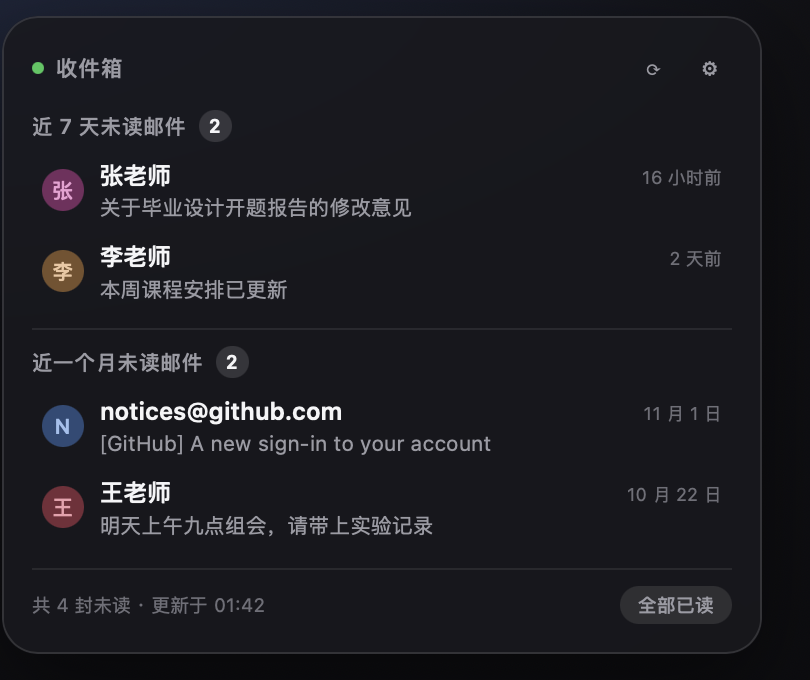

# dsh-plugin-mail-widget

DeepSeek Harness 的未读邮件挂件：**近 7 天**和**近一个月**两段未读邮件，谁发来的、什么时候，一眼看完。



- 跨平台：纯 Node 实现 IMAP（TLS），macOS / Windows / Linux 都能用
- 已在 DSH **0.2.2-rc.1** 上实测装载：插件行进入配置树、工具注册成功、挂件页面正常服务
- 零依赖：只用 Node 内置模块，不需要 keytar、也不需要编 native 模块
- 提供两个给 agent 用的工具，问一句「有几封新邮件」就能答
- 自带一个本地挂件页面，可以直接塞进 DSH 右侧边栏的浏览器里

## 安装

**用 DSH 插件页（推荐）**

设置 → 插件 → 安装，填包名：

```
dsh-plugin-mail-widget
```

装完刷新页面（或重启 DSH）。

**用命令行**

```sh
dsh plugin --profile <你的 profile> add dsh-plugin-mail-widget
```

**本地热测（还没发布时）**

```sh
npm pack                                    # 得到 dsh-plugin-mail-widget-0.1.0.tgz
dsh plugin --profile <profile> add ./dsh-plugin-mail-widget-0.1.0.tgz
```

## 首次配置

插件启动后会在本机开一个只监听 127.0.0.1 的挂件页面：

```
http://127.0.0.1:47823/
```

打开它，点右上角 ⚙：

1. 选邮箱服务商（会自动填 IMAP 服务器和端口）
2. 填邮箱地址
3. 填**应用专用密码 / 授权码**（不是网页登录密码）
4. 点「保存并测试」，看到「连接成功，当前 N 封未读」就好了

配置保存在 `~/.dsh/mail-widget/config.json`（权限 600），密码是明文存在这个文件里的——介意的话可以用专门的邮箱授权码，并只给它 IMAP 权限。

### 各家邮箱的密码怎么来

| 邮箱 | 拿密码的地方 |
|---|---|
| Gmail | Google 账号 → 安全性 → 两步验证 → 应用专用密码 |
| QQ 邮箱 / Foxmail | 网页版 → 设置 → 账号 → 开启 IMAP，用「授权码」 |
| 163 / 126 | 网页版 → 设置 → POP3/SMTP/IMAP → 开启 IMAP，用「授权码」 |
| iCloud | appleid.apple.com → 登录与安全 → App 专用密码 |
| Outlook / Microsoft 365 | 个人账号已关闭 IMAP 密码登录；学校/企业账号可能仍可用 |

## 和 agent 一起用

插件注册了两个工具：

| 工具 | 作用 |
|---|---|
| `mail_unread` | 返回未读总数 + 近 7 天 / 近一个月的发件人与主题 |
| `mail_mark_all_read` | 把收件箱里的未读全部标为已读（写操作，会先要你确认） |

对话里直接问就行：

> 帮我看看现在有几封未读邮件，都是谁发的
>
> 近一个月有哪些没读的邮件？

agent 会调用 `mail_unread` 并整理成清单。如果让它「全部标为已读」，它需要你先确认。

## 挂件页面

页面可以：

- 每 60 秒自动刷新，右上角 ↻ 手动刷新
- 两段列表，带发件人头像、主题、相对时间
- 底部显示总未读数，右侧「全部已读」（二次确认）
- 没配置时显示设置表单

放进 DSH：右侧边栏 → 打开浏览器标签 → 输入 `http://127.0.0.1:47823/`。

> 端口被占用时会自动往后找一个可用端口（最多试 10 个），实际地址看插件日志里的 `mail-widget: 挂件页面 ...`。

## 安全与隐私

- 只读为主：拉取的是邮件头（`BODY.PEEK`，不会把邮件标成已读），不下载正文、不发信、不删除
- 唯一的写操作是「全部已读」，页面上有二次确认，agent 工具的描述里也要求先问用户
- 不经过任何第三方服务器：只连你自己的 IMAP 服务器
- 配置只在本机，文件权限 600

## 已知限制

- 只支持 IMAP（不支持 Exchange WebDAV / Graph API）
- 只读收件箱 INBOX，不含归档、垃圾邮件、自定义文件夹
- 单账号
- 「近一个月」指收到时间在 8–30 天之间；30 天以前的不进列表，只计入总数
- 页面监听 127.0.0.1，只有本机能访问（不外网暴露）

## 开发

```sh
node test/run.js          # 解析 + 分段 + 标记已读的端到端测试（自带假 IMAP 服务器）
node lib/standalone.js    # 只跑挂件页面，不加载 DSH（调试用，默认 47823）
```

测试覆盖：UTF-8 Base64、Q 编码、GB2312 编码字、未编码的 8-bit GB2312 头部、裸地址、带引号姓名、两段分段、批量标已读。

源码结构：

```
lib/imap.js        极简 IMAP 客户端（TLS + UID SEARCH/FETCH/STORE，字节级 literal 解析）
lib/mail.js        头部解析、RFC 2047 解码、分段、取信/标已读
lib/store.js       配置读写 + 服务商预设
lib/index.js       Cordis 插件入口：注册工具、起挂件页面
lib/widget.html    挂件页面（无框架，单文件）
test/run.js        端到端测试
```

## 发布与上架

```sh
npm publish --access public
```

上架到插件市场需要两步：

1. 包已经在 npm 上（market 按包名安装和检查版本）
2. 向 dsh 的插件目录提交条目，材料就是本仓库的：
   - 包名 `dsh-plugin-mail-widget`
   - 一句话简介（package.json description）
   - 分类建议：效率 / 邮件
   - 截图：`assets/preview.png`
   - 兼容范围：`engines.dsh >= 0.2.0`
   - 关键词：`dsh-plugin`、`dsh`、`mail`、`imap`、`unread`

市场对条目的字段要求可能随版本调整，提交前以市场仓库的最新说明为准。

## 许可

MIT
